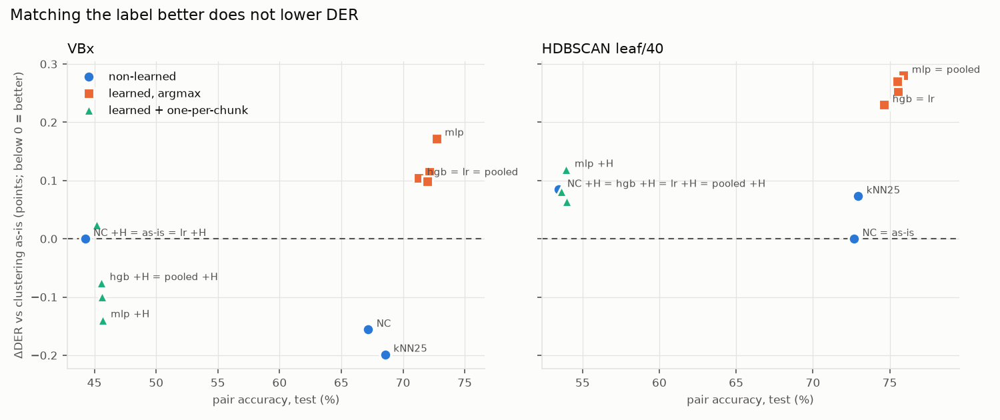
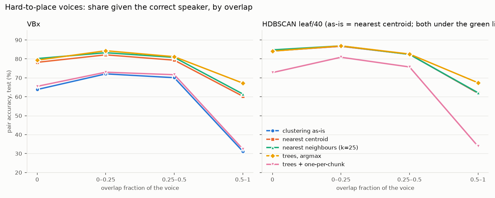
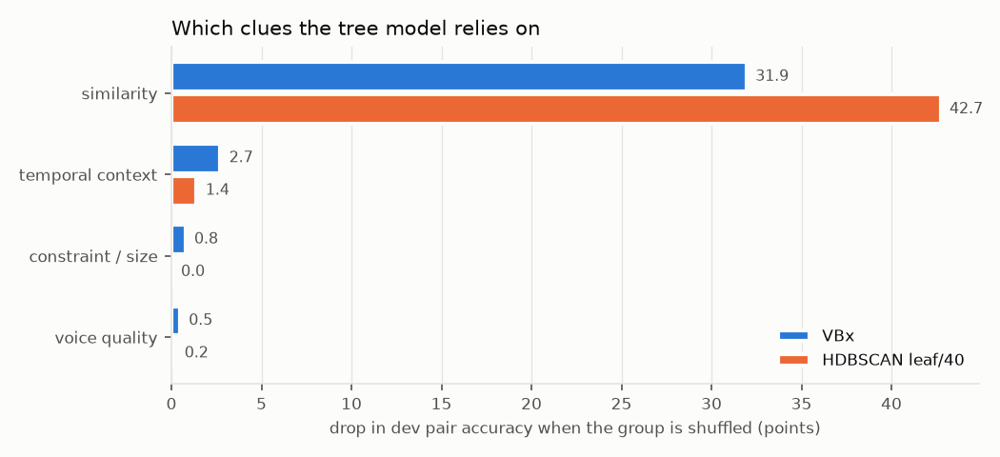

# Assignment Classifier Results

## In short

The pipeline cuts each meeting into 10 s chunks and makes one embedding (voice fingerprint) per voice per chunk. Clustering forms speakers from the clean fingerprints only. The rest are attached afterwards by a fixed rule:
- **Held back:** about 38% of active fingerprints, whose speaker talks alone for under 20% of the chunk.
- **HDBSCAN outliers:** a further share under HDBSCAN.

This work tested whether that attachment step can be done better, on top of VBx and HDBSCAN (leaf, 40). Six options were tried: three simple rules and three trained classifiers (logistic regression, gradient-boosted trees, small MLP). Each was scored on the 16 AMI IHM test meetings.

**Headline:**

- **On VBx, the best result came from a simple rule, not a trained model.** Nearest neighbours (k=25) lowered DER from 17.05% to **16.85%**: −0.20 points, 90% CI [−0.35, −0.06]. That recovers 20% of the all-pairs oracle ceiling (0.97) and 42% of the overlap-degraded one (0.47). Plain nearest centroid gave −0.16 [−0.26, −0.06]. Both are under the project's 0.3-point "clear difference" bar.
- **On HDBSCAN, nothing beat the default.** Every alternative was level or worse.
- **Trained classifiers matched the "correct" speaker best but made DER worse.** Pair accuracy rose to 71–76%, against 44% (VBx) and 73% (HDBSCAN) for the clustering as-is. DER rose by 0.10–0.28.
- **Why: the label is not DER-aligned for overlapped voices.** About half of hard-to-place voices (54% under VBx, 49% under HDBSCAN, about 68% of the most overlapped) have, as their "correct" speaker, the same person as another voice in the same chunk. Following that label merges two voices of one chunk into one speaker. The pipeline then fills the still-needed second speaker with some other cluster, which adds confusion. **Pair accuracy, as defined here, is not a usable stand-in for DER on these voices.**
- **The models lean almost entirely on embedding similarity.** Temporal context, which was predicted to matter most, adds little once similarity is known.



## What was measured

- **Pair:** one `(chunk, local_speaker)` unit with one embedding, the unit the [[Post-Clustering Refinement Hook]] decides.
- **Target pairs:** the pairs a strategy may relabel; every other pair keeps the clustering's label (enforced).
  - Under VBx: the active pairs held back by `BaseClustering.filter_embeddings` (clean single-speaker frames < 20% of the chunk, or NaN embedding).
  - Under HDBSCAN: held back, plus pairs HDBSCAN labelled noise before its fold-in.
- **Candidates:** only the clusters the clustering produced. No strategy creates or deletes a cluster, the same honest-ceiling constraint as [[Oracle Assignment Strategy]].
- **Correct label:** the cluster the oracle strategy assigns under `all_pairs`, i.e. the cluster mapped to the dominant reference speaker of the pair's active frames. It is read from the oracle closure's `labels` record, so there is one labeller, not two. Pairs with no reference overlap or an unmapped speaker are unlabelled: excluded from training and pair accuracy, but still decided and still scored in DER.
- **Pair accuracy:** correct / labelled target pairs. Reported overall and by the pair's overlap fraction: `0`, `(0, .25]`, `(.25, .5]`, `(.5, 1]`.
- **Error metrics:** the full scorer set (DER, MD, FA, Conf, `der_overlap_system`, `der_overlap_assigned`, JER, region census, count MAE/bias).
- **Intervals:** 90% paired bootstrap over the 16 test meetings (2000 draws, seed 0). ΔDER is always against the same clustering's own output (`identity`).
- **Data:**
  - fit on AMI **train** (136 meetings);
  - choose settings on AMI **dev** (18);
  - report on the usual **16 test** meetings, each frozen model run once.

## Results (test, 16 meetings)

Full table with every column: `runs/sweeps/assignment-classifier/REPORT.md`; ledger `RUN_INDEX.md`. Selected rows (DER in %, Conf in s):

| Clustering | Strategy | Pair acc [CI] | Acc by overlap bin (0 / ≤.25 / ≤.5 / >.5) | DER | Conf | `der_overlap_assigned` | ΔDER [CI] |
|---|---|---|---|---|---|---|---|
| VBx | as-is (identity) | 44.2 [40.8, 47.3] | 63.8 / 72.1 / 70.1 / 31.2 | 17.05 | 1212 | 0.2195 | – |
| VBx | nearest centroid (`nc_target`) | 67.2 [65.5, 69.1] | 78.2 / 82.1 / 79.3 / 60.3 | 16.89 | 1164 | 0.2172 | −0.16 [−0.26, −0.06] |
| VBx | one-per-chunk NC (`constrained_target`) | 44.2 | = as-is | 17.05 | 1212 | 0.2195 | 0 (identical by construction) |
| VBx | **nearest neighbours k=25** | 68.6 [66.9, 70.4] | 80.2 / 83.3 / 80.8 / 61.5 | **16.85** | 1151 | 0.2163 | **−0.20 [−0.35, −0.06]** |
| VBx | trees, argmax | 72.1 [70.6, 73.9] | 79.3 / 84.3 / 81.2 / 67.2 | 17.16 | 1247 | 0.2307 | +0.11 [−0.08, +0.33] |
| VBx | MLP, argmax | 72.7 [71.1, 74.6] | 80.0 / 83.7 / 80.8 / 68.0 | 17.22 | 1265 | 0.2342 | +0.17 [−0.01, +0.36] |
| VBx | MLP + one-per-chunk | 45.6 [42.7, 48.5] | 65.7 / 73.1 / 71.9 / 32.4 | 16.91 | 1169 | 0.2125 | −0.14 [−0.25, −0.03] |
| VBx | pooled trees + one-per-chunk | 45.6 | 65.4 / 73.0 / 71.6 / 32.5 | 16.95 | 1182 | 0.2148 | −0.10 [−0.20, 0.00] |
| HDBSCAN | as-is (= nearest centroid) | 72.7 [70.8, 74.7] | 84.2 / 86.7 / 82.4 / 61.9 | 16.86 | 1153 | 0.2132 | – |
| HDBSCAN | one-per-chunk NC | 53.5 [49.9, 56.8] | 72.2 / 79.6 / 74.4 / 33.8 | 16.94 | 1179 | 0.2125 | +0.08 [−0.01, +0.19] |
| HDBSCAN | nearest neighbours k=25 | 72.9 [71.0, 75.0] | 84.8 / 86.9 / 82.4 / 62.1 | 16.93 | 1175 | 0.2162 | +0.07 [0.00, +0.16] |
| HDBSCAN | trees, argmax | 75.5 [73.9, 77.4] | 84.1 / 86.9 / 82.6 / 67.4 | 17.11 | 1231 | 0.2247 | +0.25 [+0.15, +0.37] |
| HDBSCAN | MLP, argmax | 75.9 [74.3, 77.7] | 85.0 / 86.8 / 82.5 / 67.7 | 17.14 | 1239 | 0.2271 | +0.28 [+0.15, +0.42] |
| HDBSCAN | trees + one-per-chunk | 53.9 [50.4, 57.2] | 72.8 / 80.9 / 75.7 / 33.8 | 16.92 | 1172 | 0.2125 | +0.06 [+0.01, +0.13] |

Invariant on every run: **MD 2925.0 s, FA 1099.1 s and the region census equal the clustering's identity run** (refinement only relabels pairs). The **speaker count is also unchanged** (MAE/bias 0.250/+0.250 for VBx, 0.188/−0.188 for HDBSCAN), because no strategy emptied a cluster. Every DER change is a confusion change.

**Share of the oracle ceiling (VBx only; no oracle run exists for HDBSCAN):** nearest neighbours 20% / 42% (of 0.97 / 0.47), nearest centroid 16% / 33%, MLP + one-per-chunk 14% / 30%. Argmax classifiers recover negative shares.



**Meetings that moved most, versus as-is** (best learned point per method, points of DER):
- **VBx, MLP + one-per-chunk:**
  - gained IS1009b −0.78, ES2004b −0.43, ES2004a −0.38;
  - lost EN2002d +0.27, IS1009d +0.10, EN2002a +0.02.
- **HDBSCAN, trees + one-per-chunk:**
  - gained ES2004a −0.14, EN2002d −0.06, EN2002c −0.06;
  - lost TS3003b +0.37, TS3003d +0.35, TS3003a +0.20.

## Why pair accuracy and DER disagree

The label for a held-back voice is the reference speaker with the most speech during that voice's active frames. Held-back voices are mostly overlapped: 62–65% of them have more than half their frames in overlap. During overlap the *other* talker is often present for longer, so the label frequently names the co-talker.

Across the 16 test meetings, **54.4% of labelled target voices under VBx (11,666 / 21,437) and 49.3% under HDBSCAN (13,576 / 27,552) have the same label as another active voice in the same chunk**, rising to 68% in the most overlapped bin.

Consequences:
- **VBx's own assignment is a per-chunk Hungarian**, so two voices in a chunk never share a cluster (`constrained_assignment=True`, `clustering.py:559, 658-663`). That is why VBx scores only 31% in the high-overlap bin against these labels. HDBSCAN uses plain argmax and scores 62%.
- **A model trained on these labels learns to merge co-talkers.** The more accurately it does so, the worse DER gets. `reconstruct()` still fills as many speakers per frame as segmentation counted, and with two voices merged into one cluster, the second slot goes to some other cluster. Confusion and `der_overlap_assigned` both rise for every argmax classifier.
- **Adding the one-per-chunk step back on top of a classifier** returns pair accuracy to about the clustering's own level, but lowers DER slightly. The classifier's *second* choice for a constrained voice is better than nearest centroid's.
- **On VBx, `constrained_target` is identical to as-is.** VBx already solves the joint per-chunk assignment over the same cosine scores, so with the clean voices' labels fixed, its choice for the held-back voices is already optimal. The runs differ only in their cache id. This is a mathematical identity, not a cache hit: refinement ids differ and pair decisions match exactly.

The oracle's own DER gain (−0.97 all pairs) still comes from these labels, because the oracle relabels *every* pair at once, clean voices included, so merges are consistent. Applied to held-back voices alone, the same labels are not a good target.

## Which clues matter

Permutation importance on dev for the trees model (feature groups permuted jointly, 5 repeats), as the drop in dev pair accuracy:

| Group | Features | VBx | HDBSCAN |
|---|---|---|---|
| Similarity | cosine to centroid, rank, margin, soft score, kNN similarity (k=10) | **31.9** | **42.7** |
| Temporal | label agreement of matched neighbours ±1 / ±5 chunks, candidate activity ±30 s | 2.7 | 1.4 |
| Constraint / size | candidate already taken in chunk, candidate's share of the meeting | 0.8 | 0.0 |
| Quality | overlap fraction, clean ratio, active ratio, embedding norm | 0.5 | 0.2 |

Retraining without a group, evaluated on dev:
- **without temporal:** 71.9 / 76.2, i.e. −0.2 / −0.1 points;
- **without similarity:** 57.8 / 50.1.

Temporal context is largely redundant with similarity.



## Training-data shift

community-1's segmentation and embedding models were likely trained on data including AMI train. This was not verified against a model card (assumption A7 stays "likely").

| Split | VBx DER | HDBSCAN DER | VBx as-is acc | VBx NC acc | HDBSCAN acc |
|---|---|---|---|---|---|
| train (136) | **15.65** | 17.07 | 46.8 | 68.9 | 72.6 |
| dev (18) | 16.90 | 17.19 | 51.4 | 70.5 | 75.6 |
| test (16) | 17.05 | 16.86 | 44.2 | 67.2 | 72.7 |

- **VBx DER is clearly lowest on train**, consistent with the models having seen it.
- **Pair accuracy on train sits between dev and test**, so the "train looks cleaner" effect does not show up at the assignment step.
- **HDBSCAN beats VBx on test but not on dev or train**, which adds to the clustering benchmark's caution that HDBSCAN's test-half gain isn't robust.
- **Models trained on dev only** (same settings, no reselection): pair accuracy slightly *lower* than train-trained (VBx 71.0 vs 72.1; HDBSCAN 74.7 vs 75.5). DER is slightly less bad (VBx argmax −0.03 vs +0.11; HDBSCAN +0.19 vs +0.25), consistent with a weaker label fit producing fewer merges.

## Predictions vs outcomes

The predictions were recorded before the work started.

| Prediction | Outcome |
|---|---|
| NC pair accuracy is lower in high-overlap bins than in the `0` bin | **Held** (VBx NC 78 → 60; HDBSCAN 84 → 62) |
| `constrained_target` gives a small, non-zero gain | **Did not hold.** Identical on VBx (by construction); +0.08 on HDBSCAN |
| Best learned model beats NC on pair accuracy by several points but DER ≤ ~0.3 better, gains in Conf only | **Partly.** +5 points pair accuracy on VBx and +3 on HDBSCAN, but DER got *worse* (argmax). Only the one-per-chunk variants gained, ≤ 0.14 |
| Temporal context is the most important feature group | **Did not hold.** Similarity dominates |
| Gains on HDBSCAN larger than on VBx | **Did not hold.** HDBSCAN lost more |
| Train NC accuracy higher than dev/test | **Did not hold.** Train is between dev and test |
| Any VBx gain > 0.97 means a bug | Not triggered (largest −0.20) |

## Decisions that differ from the original ticket

These were made with stated defaults while the owner was away; the reasoning is kept here so they can be revisited.

1. **The floor under VBx is the clustering's own output, not "nearest centroid".** Because VBx assigns with a per-chunk Hungarian, plain NC on VBx is a different strategy (DER 16.89). The check "`nc_target` reproduces `identity` exactly" therefore applies to HDBSCAN only, where it passes bit-for-bit.
2. **Test labels never enter the dataset.** Test rows have `is_label = NaN`. A separate pair evaluator computes test labels for pair accuracy only.
3. **Run conditions reused.** `baseline` (VBx) and `clustering_hdbscan`; runs differ by `refinement_strategy`.
4. **Datasets are gzip CSV, not parquet** (`pyarrow` is not installed).
5. **The oracle's label definition was kept** despite the collision finding, so results stay comparable with the 0.97 / 0.47 ceilings.

## Open follow-ups

- **A collision-free label.** Match a chunk's voices to reference speakers one-to-one before mapping to clusters. Then retrain, or select models on dev DER rather than pair accuracy. This is the most direct way to test whether a learned assignment can beat nearest neighbours.
- **Nearest neighbours as a VBx option.** It's the best result here and needs no training, but its gain is under the 0.3 bar. A larger evaluation (e.g. dev + test, or more corpora) would be needed before adopting it.

## How to reproduce

```bash
# data (AMI-diarization-setup checkout; see [[AMI Corpus Setup]] → AMI train/dev)
bash pyannote/download_ami_split.sh {dev,train} pyannote
bash pyannote/convert_for_harness.sh <harness-data> {dev,train}
# cold caching, one GPU run per split (VBx identity); HDBSCAN then runs from cache
python run_harness.py --data-root <harness-data> --split {dev,train} --device cuda --refinement-strategy identity ...

python -m harness.assignment_dataset build --split {train,dev,test} --method {vbx,hdbscan}
python -m harness.assignment_eval test-labels --method {vbx,hdbscan}     # evaluator-only test labels
python -m harness.assignment_eval floors                                  # dataset_stats.md
python -m harness.assignment_models grid --method {vbx,hdbscan,pooled}   # dev_selection.csv
python -m harness.assignment_runs run <point> <method> <strategy> [--model-id ...]
python -m harness.assignment_analysis {importance,ablation}               # dev only
python -m harness.assignment_report                                       # REPORT.md + figures
```

Any refinement strategy can also be run directly: `run_harness.py --refinement-strategy knn_target_k25`, or `classifier:<model_id>` / `classifier_hungarian:<model_id>`.

## How it fits into the code

- **`harness/assignment_common.py`:** rebuilds a meeting's clustering on CPU from the [[Pre-Clustering Cache]] with exactly the arguments `apply()` passes. Returns a `ClusteredMeeting`: hard/soft clusters, centroids, active/held-back/outlier masks.
- **`harness/assignment_labels.py`:** the only reader of reference RTTMs in this work. `load_reference(split, uri, purpose)` refuses test references unless `purpose == "pair-eval"`.
- **`harness/assignment_dataset.py`:** one row per (target pair, candidate) with 17 features in four groups. Context features align neighbour chunks by time: frame f of chunk c ↔ frame f − round(d·step/frame_dur) of chunk c+d.
- **`harness/assignment_strategies.py`:** `nc_target`, `constrained_target`, `knn_target_k{5,10,25}`, `classifier:<id>`, `classifier_hungarian:<id>`.
  - Each is a `decide(meeting)` shared by the offline evaluator and the in-pipeline hook, so the two cannot drift.
  - In the hook, HDBSCAN outliers are read from `pipeline.clustering.last_diagnostics`, valid because refinement runs straight after clustering in the same `apply()`.
  - `checked_decision` raises if any non-target pair changes.
- **`harness/assignment_models.py`:** grids, selection (dev pair accuracy; ties within 0.2 points go to the simpler setting), freezing (`models/<id>/model.joblib`, `config.json`, `sha256.txt`; never overwritten), and inference. The model's sha256 is part of the strategy's `refinement_id`, so a retrained model can never share a final cache key.
- **`harness/assignment_eval.py`, `harness/assignment_runs.py`, `harness/assignment_analysis.py`, `harness/assignment_report.py`:** pair accuracy, the test-run driver and ledger, the WS5 analyses, and the report.
  - The driver enforces three checks on every point: MD/FA/region census equal to identity, a unique refinement id, and 16/16 intermediate-cache hits.
  - It identifies a run's manifest by its notes.
- **Registration:**
  - `harness/refinement.py`: `get_refinement_strategy(name, pipeline=None)`, `is_valid_refinement_strategy`, `refinement_id_for`. The oracle closure now also records `strategy.labels`; its output is unchanged.
  - `run_harness.py`: CLI validation instead of fixed `choices`.
  - `harness/run_manifest.py`: new names plus the `classifier:` / `classifier_hungarian:` prefixes.
  - Nothing in `runner.py`, `cache_id.py` or `speaker_diarization.py` changed.
- **Tests:**
  - `tests/test_assignment_common.py`: A3–A5 on a real meeting.
  - `test_assignment_dataset.py`: temporal matcher; test-reference guard (patches the loader and fails if building test rows reads any reference).
  - `test_assignment_strategies.py`: hook == offline; HDBSCAN `nc_target` == identity; non-target guard.
  - `test_assignment_models.py`: freeze, sha256, distinct ids for distinct models, tamper refusal.

## Gotchas

- **Plain nearest centroid is not VBx's rule.** VBx assigns with the per-chunk Hungarian; that's the source of the "nearest centroid = baseline exactly" claim once made in [[Post-Clustering Refinement Hook]]. That old number came from the pre-`a4a3101a` cache bug; the real figure is 16.79–16.89% depending on scope.
- **Inactive local-speaker slots carry non-NaN embeddings.** Always select pairs by activity, never by NaN.
- **Concurrent harness runs break "new file in `runs/`" detection.** One dev-only point (`vbx-classifier-devonly`) hit this. Its harness run completed once and was finalised from its outputs, not re-run. The driver now matches by notes.
- **Git Bash here lacks `jq`, `pgrep` and `node`.** The Windows console is cp1252, so set `PYTHONIOENCODING=utf-8` when printing ≤ or Δ.
- **Train datasets (56 MB + 69 MB) are gitignored** and are rebuilt by the dataset builder in about 9 minutes each.

## Provenance

- Branch `assignment-classifier` (off `clustering-benchmark`).
- Identity references: VBx `20261003T044356Z-0fa3b41d`, HDBSCAN `20261003T044452Z-b96eddd3`.
- Split baselines: dev VBx `20261003T055158Z-c9fcfc74`; train runs in `runs/sweeps/assignment-classifier/ws1/`.
- Every test point's run id is in `RUN_INDEX.md` / `runs.jsonl`; frozen models with hashes are in `models/`.

## See also

[[Oracle Assignment Strategy]] · [[Oracle Ceiling Metrics]] · [[Post-Clustering Refinement Hook]] · [[Clustering Benchmark Results]] · [[Pre-Clustering Cache]] · [[AMI Corpus Setup]] · [[Evaluation Harness]] · [[Run Manifest]]
