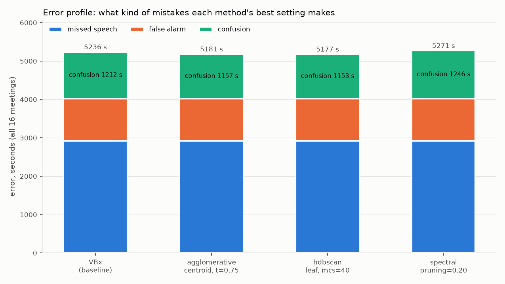
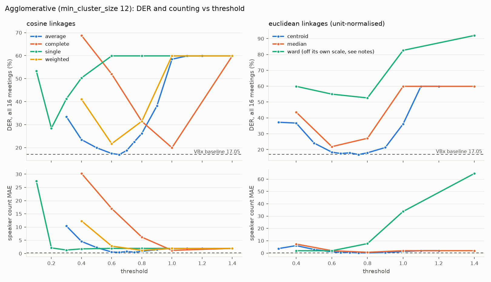
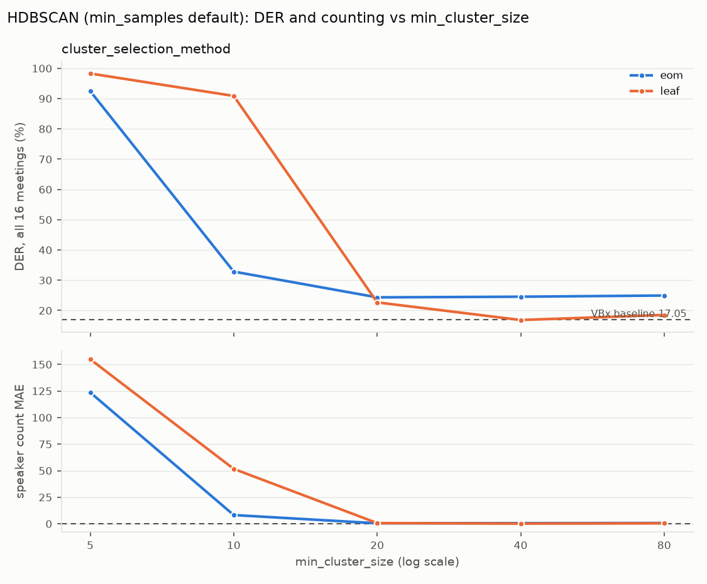
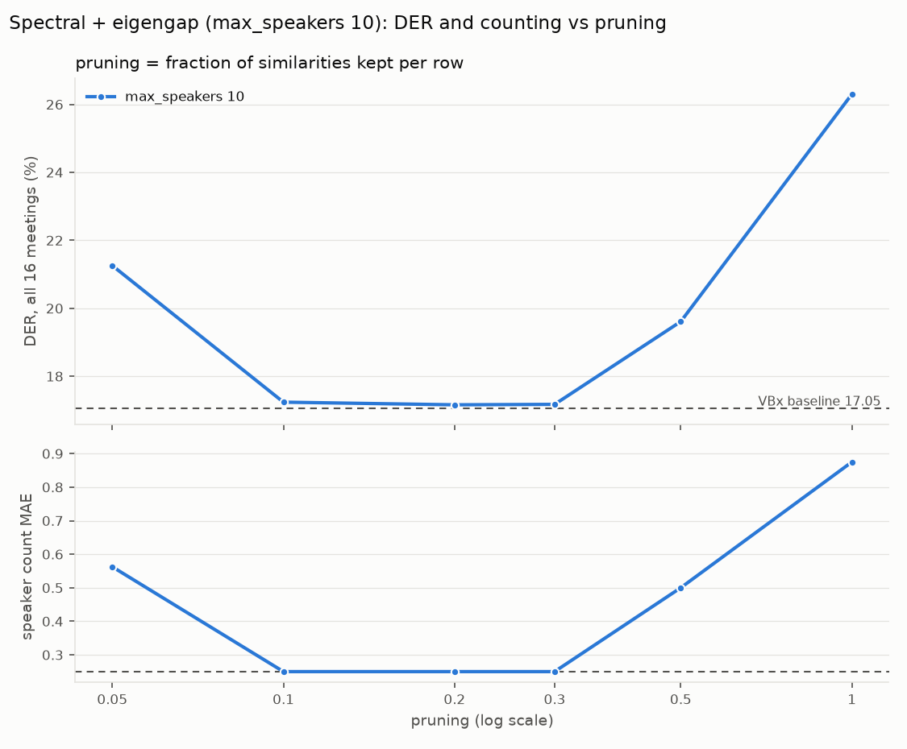

# Clustering Benchmark Results

## In short

This benchmark swapped the pipeline's clustering step (the shipped default is VBx) for three other methods and measured diarisation on the 16 AMI IHM test meetings:
- agglomerative;
- HDBSCAN;
- spectral clustering with an eigengap speaker count.

All runs used the pipeline's own segmentation and embeddings. Nothing was retrained.

**Headline:** none of the three is clearly better than VBx overall. Their best settings land within about 0.2 DER points of VBx's 17.05% across all 16 meetings.
- **Agglomerative:** level with VBx, with slightly better speaker counting.
- **HDBSCAN:** the most interesting result. It beat VBx on the held-out report half by 0.55 points, with a 90% interval that excludes zero, and counted speakers exactly in 14/16 meetings. But it was *worse* than VBx on the half its setting was chosen on, so the gain isn't robust across halves.
- **Spectral:** level with VBx.
- **Every method is very sensitive to its settings.** A step off the best value often costs 5–40 points.

**The most important structural finding:** in this pipeline, clustering can only change *confusion* (speech credited to the wrong speaker) and the speaker count. Missed speech, false alarm and every overlap-region duration are identical for every clustering method and setting. The segmentation stage alone decides how many people are talking in each frame.



## Results

The best setting for each method was chosen on the **tune half** only (meetings ending in a/c), then reported on the **report half** (meetings ending in b/d). The Δ column is report-half DER minus VBx, with a 90% paired bootstrap interval (2000 resamples of the report-half meetings, seed 0). DER is in %; MD/FA/Conf are seconds over all 16 meetings.

| Method | Setting | DER tune | DER report | DER all | MD s | FA s | Conf s | Count MAE | Exact /16 | Δ DER report vs VBx [90% CI] |
|---|---|---|---|---|---|---|---|---|---|---|
| VBx (baseline) | Fa=0.07, Fb=0.8, threshold=0.6 | 16.26 | 17.73 | 17.05 | 2925.0 | 1099.1 | 1212.2 | 0.250 | 12 | – |
| Agglomerative, best | centroid, min_cluster_size 12, threshold 0.75 | 16.10 | 17.54 | 16.87 | 2925.0 | 1099.1 | 1156.6 | 0.188 | 13 | −0.20 [−0.65, +0.31] |
| Agglomerative, worst | single linkage family collapses; worst swept point ward 1.4 (off-scale, see below) | 91.08 | 92.75 | 91.98 | 2925.0 | 1099.1 | 24225.1 | 64.6 | 0 | +75.0 |
| HDBSCAN, best | leaf, min_cluster_size 40, min_samples default | 16.48 | 17.18 | 16.86 | 2925.0 | 1099.1 | 1152.7 | 0.188 | 14 | **−0.55 [−1.08, −0.14]** |
| HDBSCAN, worst | leaf, min_cluster_size 5 | 97.77 | 98.77 | 98.31 | 2925.0 | 1099.1 | 26169.8 | 154.9 | 0 | +81.0 |
| Spectral, best | pruning 0.20, max_speakers 10 | 16.35 | 17.86 | 17.16 | 2925.0 | 1099.1 | 1246.4 | 0.250 | 13 | +0.13 [−0.87, +1.45] |
| Spectral, worst | pruning 1.00 (no pruning), max_speakers 10 | 19.24 | 32.40 | 26.30 | 2925.0 | 1099.1 | 4053.6 | 0.875 | 7 | +14.7 |

**Reading rule.** Gaps under 0.3 DER points, or intervals that cross zero, count as "no clear difference". On that rule:
- **Agglomerative and spectral:** no clear difference from VBx.
- **HDBSCAN:** passes on the report half, with the caveats in its section below.

**A tie worth knowing about:** AGG-1c-05 (centroid, threshold 0.75, min_cluster_size **20**) ties AGG-1a-07 exactly on both tune-half DER and tune-half MAE.
- On the report half it scores 17.19 with 8/8 counts exact, which looks better.
- The selection rule breaks a full tie by keeping the earlier-swept point. Picking 1c-05 because its report-half number is lower would mean selecting on report data, which this benchmark forbids.
- 20 is also the top of `min_cluster_size`'s declared range, so nothing beyond it could be tested.

## Clustering only moves confusion

Across all 79 sweep points, `missed_detection` (2925.0 s), `false_alarm` (1099.1 s) and the three overlap regions (caught 2433 s, missed 1394 s, invented 383 s) never move. Only `confusion` and the speaker count do.

The mechanism, from `src/pyannote/audio/pipelines/speaker_diarization.py`:
- **The talker count per frame comes from segmentation alone.** `speaker_count(binarized_segmentations)` (≈:625) sets how many speakers are active in each frame, using only the segmentation.
- **Clustering only names those talkers.** `reconstruct` / `to_diarization` then fill that many slots per frame from the clusters.
- **Missing slots are padded.** If there are fewer clusters than active speakers, extra labels are created (comment at ≈:784).
- **So overlap can't be erased by merging.** A method that merges two overlapping speakers into one cluster still produces two speakers in that frame. Speech detection and overlap detection belong to segmentation.

Consequences:
- Every DER difference between clustering methods in this pipeline is a confusion difference. The ceiling on what clustering can win is the baseline's 1212 s of confusion, 23% of total error. Missed speech is 56%.
- **The "single-cluster collapse" output:** when a method merges everything into one cluster, every meeting comes out with exactly **2** speakers (one cluster plus the overlap padding label) and DER 59.90%.
  - This output is byte-identical whichever method produces it.
  - It happens with agglomerative at threshold ≥ 1.10, single linkage from 0.6 up, and several other linkages at their high thresholds.

## Error profiles

Best point per method. "Report" rows use the report half; asterisked values are the mean of per-file values, not corpus-level.

| Method | Half | MD / FA / Conf s | MD / FA / Conf % of error | der_overlap_system | der_overlap_assigned | JER | overlap caught / missed / invented s | count MAE | signed bias | over / under / exact |
|---|---|---|---|---|---|---|---|---|---|---|
| VBx (baseline) | all | 2925 / 1099 / 1212 | 55.9 / 21.0 / 23.1 | 0.3339 | 0.2195 | 0.2219 | 2433 / 1394 / 383 | 0.250 | +0.250 | 4 / 0 / 12 |
| VBx (baseline) | report | 1517 / 653 / 751 | 51.9 / 22.3 / 25.7 | 0.3537\* | 0.2382\* | 0.2172\* | 1334 / 712 / 224 | 0.250 | +0.250 | 2 / 0 / 6 |
| Agglomerative (AGG-1a-07) | all | 2925 / 1099 / 1157 | 56.5 / 21.2 / 22.3 | 0.3311 | 0.2167 | 0.2257 | 2433 / 1394 / 383 | 0.188 | +0.062 | 2 / 1 / 13 |
| Agglomerative (AGG-1a-07) | report | 1517 / 653 / 719 | 52.5 / 22.6 / 24.9 | 0.3455\* | 0.2255\* | 0.2150\* | 1334 / 712 / 224 | 0.250 | +0.250 | 2 / 0 / 6 |
| HDBSCAN (HDB-2b-04) | all | 2925 / 1099 / 1153 | 56.5 / 21.2 / 22.3 | 0.3285 | 0.2132 | 0.2432 | 2433 / 1394 / 383 | 0.188 | −0.188 | 0 / 2 / 14 |
| HDBSCAN (HDB-2b-04) | report | 1517 / 653 / 660 | 53.6 / 23.1 / 23.3 | 0.3389\* | 0.2167\* | 0.2116\* | 1334 / 712 / 224 | 0.000 | +0.000 | 0 / 0 / 8 |
| Spectral (SPC-3a-03) | all | 2925 / 1099 / 1246 | 55.5 / 20.9 / 23.6 | 0.3291 | 0.2139 | 0.2552 | 2433 / 1394 / 383 | 0.250 | −0.250 | 0 / 3 / 13 |
| Spectral (SPC-3a-03) | report | 1517 / 653 / 772 | 51.6 / 22.2 / 26.2 | 0.3465\* | 0.2280\* | 0.2370\* | 1334 / 712 / 224 | 0.125 | −0.125 | 0 / 1 / 7 |

Overlap-assigned DER (the project's core metric) improves slightly with all three methods: VBx 0.2195, agglomerative 0.2167, HDBSCAN 0.2132, spectral 0.2139. These are differences of a few thousandths, inside the noise for 16 meetings.

**Strengths and weaknesses**, one line each, from the numbers above:

- **VBx.** *Strength:* no meeting goes badly wrong; it never under-counts. *Weakness:* it over-counts (+1 speaker on 4/16 meetings, signed bias +0.25).
- **Agglomerative (centroid 0.75).**
  - *Strength:* the most balanced counter (bias +0.06; 2 over, 1 under) and 55 s less confusion than VBx.
  - *Weakness:* a narrow sweet spot. Threshold 0.70 or 0.80 costs 1–1.1 points, and other linkages lose 3–40 points. Its worst meeting is EN2002b (+1.78 vs VBx).
- **HDBSCAN (leaf, 40).**
  - *Strength:* the least confusion (1153 s, −59 s vs VBx) and perfect counting on the report half (8/8).
  - *Weakness:* it leans to **under-counting** (2 meetings, bias −0.19). That shows in JER (0.2432 vs 0.2219): merging a quieter speaker costs that speaker's whole share, so the speaker-balanced score suffers even though DER doesn't. Its worst meeting is IS1009a (+4.05 vs VBx).
- **Spectral (pruning 0.20).**
  - *Strength:* very stable for pruning between 0.10 and 0.30 (DER 17.16–17.24, MAE 0.25 throughout), and `max_speakers` doesn't matter, because the estimate never exceeded 4.
  - *Weakness:* under-counts (3 meetings, bias −0.25) and has the worst JER (0.2552). Its worst meetings are IS1009d (+6.04) and IS1009a (+3.93).

**Meetings that moved most relative to VBx** (per-meeting DER, points; negative = better than VBx):

- **Agglomerative:** best IS1009b −1.34, ES2004b −0.82, ES2004a −0.65; worst EN2002b +1.78, TS3003a +0.35, EN2002d +0.25.
- **HDBSCAN:** best IS1009b −2.48, ES2004b −0.81, TS3003d −0.68; worst IS1009a +4.05, TS3003a +1.81, EN2002d +0.28.
- **Spectral:** best IS1009b −2.34, TS3003d −0.79, ES2004a −0.74; worst IS1009d +6.04, IS1009a +3.93, TS3003a +1.81.

A pattern by recording series:
- **IS1009 is where methods disagree most.** All three beat VBx on IS1009b, and HDBSCAN and spectral lose heavily on IS1009a/d, the under-counting cases.
- **TS3003a is worse than VBx for all three.**
- **EN2002 is mostly neutral.**

## Per method

### Agglomerative

Greedy merging of embeddings, treated as an unordered set. The pipeline's existing `AgglomerativeClustering` class, unchanged. Full reference: [[Clustering Method - Agglomerative]].



- **Centroid** (best 0.75, all 16.87) and **average** (best 0.65, all 17.03) are the only linkages that reach VBx's level. Both have a U-shaped curve: too low a threshold over-splits, too high merges everything.
- **Complete** is best at 1.0 (19.99). **Weighted** and **median** are best at 0.6 (21.7–21.8).
- **Single** linkage chains everything into one cluster from 0.6 up. Its best is 0.2 (28.46), after three edge points below the grid.
- **Ward was not tested on its own scale.** Its merge heights are much larger than the other linkages': on IS1009a's embeddings its last merges sit at 6.5–38.5, against about 1.1 for centroid. At the grid's 0.4–1.4 every ward cluster is a tiny fragment. A proper ward test needs thresholds around 4–20, which is outside the class's declared `Uniform(0.0, 2.0)` range. It is listed as untested, not as a loser.
- **`min_cluster_size` matters a lot**, against the original prediction. Clusters smaller than it are absorbed into large ones, which is what keeps the speaker count down. At centroid 0.75, sizes 1, 3 and 6 over-count massively (MAE 43.6 / 15.9 / 9.3), while 12 and 20 are best.
- **Count MAE is not monotonic at very low thresholds** (centroid 0.30 → 3.6, 0.40 → 6.1). When almost every cluster is below `min_cluster_size`, the count depends on how many reach it, not on the threshold.
- **The runtime shrink of `min_cluster_size` never applies on this corpus.** It caps the setting at 10% of the embedding count, and the smallest meeting has 850 training embeddings (IS1009a), so the size used always equals the size requested.

### HDBSCAN

A density-based method. It finds dense clumps of similar embeddings and marks the rest as outliers. It's new in `clustering.py` as `HDBSCANClustering`. Full reference: [[Clustering Method - HDBSCAN]].



- **The `min_cluster_size` threshold:** below about 20, HDBSCAN fragments speakers into dozens of clusters (MAE up to 155).
- **`eom` selection** plateaus around 24–25% DER.
- **`leaf` selection** reaches 16.86 at 40, then rises again at 80 (18.53).
- **Lowering `min_samples` to 1 or 5** at leaf/40 is disastrous: DER 65–69%, with about 50% of embeddings becoming outliers.

**Outliers at the best point (HDB-2b-04).**
- **How many:** 6,460 of 35,356 training embeddings (**18.3%**) were left unassigned by HDBSCAN.
- **How the model did after folding them in:** each outlier was folded into its nearest cluster centroid, and the result is the 16.86% above.
- **Outliers carry more overlap:** their mean overlap fraction is **0.206** against **0.107** for non-outliers, and 68.7% of them have *some* overlap against 56.4% of non-outliers. Overlap fraction is the share of that speaker's active frames in the chunk where 2+ speakers are active.
- **Rates vary a lot by meeting:** from 3.1% (ES2004c) to 36.8% (TS3003d). EN2002 and ES2004d/TS3003d sit near 30%.

**What happens to heavily overlapped embeddings, for every method.**
- Before any clustering method sees the embeddings, the pipeline's own filter (`BaseClustering.filter_embeddings`) holds back every embedding whose speaker talks *alone* for less than 20% of the 10 s chunk.
- That is **38.1%** of all active embeddings on this corpus, the same for every method.
- Held-back embeddings are **not failed**: `assign_embeddings` still assigns them to the nearest centroid. They just never help form the clusters.
- So the most overlap-heavy embeddings are invisible to HDBSCAN's outlier detection. Its outliers come only from the lightly overlapped 62%.

### Spectral with eigengap

The method builds a "who sounds like who" graph and estimates the speaker count from the largest gap in the graph Laplacian's spectrum (the "eigengap"). It then partitions the graph into that many groups. It's new in `clustering.py` as `SpectralEigengapClustering`. Full reference: [[Clustering Method - Spectral]].



- **Flat from pruning 0.10 to 0.30** (DER 17.16–17.24, count MAE 0.25, 13/16 exact).
- **Over-pruned (0.05):** the estimate drifts upward (k up to 6, DER 21.3).
- **Under-pruned:** the graph is too connected and the eigengap under-counts. At 1.00 k drops to 1 on one meeting, giving DER 26.3, and 32.4 on the report half.
- **`max_speakers` 6, 10 and 15 give identical results.** The estimated k ranged 2–4, so the cap never bound. The cache keys differed, so this is a real result.
- **Speed:** about 2.5 s per meeting for the clustering step.
- **Standalone counting:** used purely as a speaker counter, the eigengap at pruning 0.20 gets MAE 0.25 and 13/16 exact, against VBx's 0.25 and 12/16. It under-counts where VBx over-counts.

## Predictions vs outcomes

The predictions were recorded before running.

| Prediction | Outcome |
|---|---|
| Agglomerative best within ±1.5 of 17.05 | **Held** (16.87) |
| Agglomerative count falls steadily as threshold rises | **Partly:** true above 0.4; not at the low end (min_cluster_size absorption) |
| Agglomerative DER curve flatter than counting curve | **Did not hold:** DER moves as sharply as counting |
| HDBSCAN 1–3 points worse than VBx | **Did not hold:** level overall, better on report half |
| HDBSCAN outlier rate > 10% | **Held** at most settings (18.3% at best; 9.5% at eom ≥ 20) |
| Outliers have higher mean overlap fraction | **Held** (0.206 vs 0.107) |
| Spectral within ±1 of VBx | **Held** (17.16) |
| Eigengap under-counts with light pruning | **Held** (pruning 1.00: k down to 1) |
| Any method > 1 point better than VBx is a suspected bug | Not triggered (largest gain −0.55 on report half) |

## Method

- **Data:** AMI IHM test, 16 meetings, `AMI.SpeakerDiarization.only_words`, baseline segmentation. No oracle conditions, no retraining.
- **Split, fixed before any result:**
  - **Tune half:** meetings ending in a/c (EN2002a/c, ES2004a/c, IS1009a/c, TS3003a/c).
  - **Report half:** meetings ending in b/d.
  - The split is shared with [[clustering-vbx]].
- **Half-level DER:** sum(MD + FA + Conf) / sum(reference speech) over that half's per-file rows. On all 16 it reproduces each run's summary DER exactly; the driver checks this on every point.
- **Selection:** lowest tune-half DER. Ties within 0.1 points go to the lower tune-half count MAE, and full ties keep the earlier-swept point. Report-half numbers are never used to choose.
- **Outliers (HDBSCAN):** embeddings labelled noise are folded into the nearest non-noise centroid (cosine) inside `cluster()`, so no label is ever negative.
- **Compute:**
  - 79 sweep points, each a full scored 16-meeting run through `run_harness.py`.
  - Each takes about 30–60 s on CPU, using cached segmentation and embeddings (16/16 intermediate-cache hits on every point).
  - The slowest were HDBSCAN at very small `min_cluster_size` (up to 184 s).
- **Determinism:** the same configuration run twice, with an empty final-RTTM cache the second time, gives identical DER (difference 0.0) and byte-identical per-file CSVs.

## Grid that was run

| Step | Method | Varied | Points |
|---|---|---|---|
| WS0 | agglomerative | centroid / 12 / 0.70 twice ("3.1-like setting, unverified"; determinism check) | 2 |
| 1a, 1b | agglomerative centroid, average | threshold 0.30–1.20 (12 values), min_cluster_size 12 | 24 |
| 1c | agglomerative centroid 0.75 | min_cluster_size 1, 3, 6, 12, 20 | 5 |
| 1d | complete, single, weighted, median, ward | threshold 0.4, 0.6, 0.8, 1.0, 1.4 + single edge points 0.1, 0.2, 0.3 | 28 |
| 2a, 2b | HDBSCAN eom, leaf | min_cluster_size 5, 10, 20, 40, 80 | 10 |
| 2c | HDBSCAN leaf 40 | min_samples 1, 5 | 2 |
| 3a | spectral | pruning 0.05, 0.10, 0.20, 0.30, 0.50, 1.00 (max_speakers 10) | 6 |
| 3b | spectral pruning 0.20 | max_speakers 6, 15 | 2 |

Not run:
- **Ward on its own threshold scale (about 4–20).** This needs a grid change outside the class's declared range. It was proposed and not approved before close.
- **KMeans, an outlier classifier, other corpora:** out of scope.

## Using the tooling

```bash
# one sweep point (writes runs/sweeps/clustering-benchmark/<method>/<point_id>/, a manifest in runs/,
# and updates points.jsonl, SWEEP_INDEX.md and all_points_per_file.csv)
python -m harness.clustering_benchmark run HDB-2b-04 WS2 hdbscan \
    min_cluster_size=40 min_samples=0 cluster_selection_method=leaf

# best point on the tune half among point-id prefixes
python -m harness.clustering_benchmark_report best HDB-2a HDB-2b

# regenerate REPORT.md and figures/
python -m harness.clustering_benchmark_report report
```

On every point, the driver enforces the benchmark's hard-fail rules:
- **Cache tally:** it must be exactly `16 full hit(s), 0 partial, 0 miss(es), 0 write(s)`. The one exception is a repeat of an earlier configuration, which is served whole from the final-RTTM cache.
- **Manifest:** `clustering_config` must name the requested class and every requested value.
- **Cache keys:** no final-key collision between different configurations.
- **Stuck settings:** no three consecutive byte-identical per-file CSVs, except the verified single-cluster collapse, which is labelled as such.

**Gotcha:** to recompute a point without its cached RTTMs, point `--cache-dir` at a folder holding a **copy of `.harness_cache/intermediates/`**. An empty folder also empties the intermediate tier and forces a cold GPU run (about 37 min). Retrying a failed point with a bare `--force` is served from the RTTM cache that the failed attempt wrote.

## Files

- **Library:** `src/pyannote/audio/pipelines/clustering.py` contains `HDBSCANClustering` and `SpectralEigengapClustering`, plus their `Clustering` enum entries. Existing classes are unchanged.
- **Harness:**
  - `harness/run_manifest.py`: `hdbscan` and `spectral` in `VALID_CLUSTERING_MODELS`; `clustering_agglomerative`, `clustering_hdbscan`, `clustering_spectral` in `VALID_CONDITIONS`.
  - `run_harness.py --clustering-diagnostics-dir`: writes any `last_diagnostics` a clustering class leaves on itself. It is reset before every file, so a final-RTTM cache hit can't inherit stale values.
- **Benchmark tooling:** `harness/clustering_benchmark.py` (driver and ledger) and `harness/clustering_benchmark_report.py` (selection, paired bootstrap, tables, charts).
- **Tests:** `tests/test_clustering_benchmark_methods.py`; `tests/test_clustering_model_selection.py` and `tests/test_run_manifest.py` updated for the new names.
- **Outputs, under `runs/sweeps/clustering-benchmark/`:**
  - `SWEEP_INDEX.md` (every point) and `points.jsonl`;
  - `all_points_per_file.csv` (long format, with `point_id`, `method`, `half`);
  - `REPORT.md` and `figures/`;
  - per-point folders with `per_file.csv`, `summary.json` and `diagnostics.json`, plus `outliers.csv` for HDBSCAN.
- **Run provenance:**
  - Baseline: `runs/20260925T101811Z-db977741.json`.
  - Best points: AGG-1a-07 `20261003T003611Z-da03276c`, AGG-1c-05 `20261003T004959Z-0296dceb`, HDB-2b-04 `20261003T012018Z-b15caf86`, SPC-3a-03 `20261003T012326Z-fda86985`.
  - Branch `clustering-benchmark`.
  - A few extra manifests in `runs/` come from hard-fail retries; the ledger holds only the passing record.

## See also

- [[clustering-method-comparison]]: the epic; its results table carries these rows.
- [[clustering-vbx]]: VBx's own hyperparameter review; reuses this split.
- [[Clustering Method - Agglomerative]], [[Clustering Method - HDBSCAN]], [[Clustering Method - Spectral]].
- [[Pre-Clustering Cache]]: why every sweep point costs seconds, not a GPU run.
- [[Evaluation Harness]], [[Run Manifest]].
