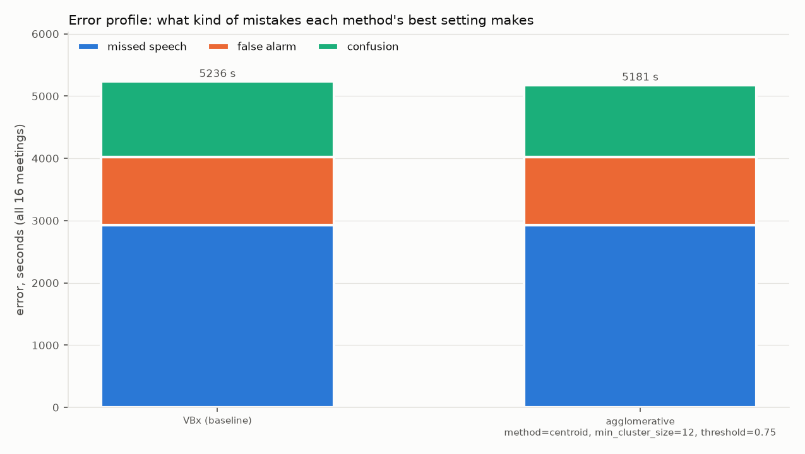

# Clustering benchmark report (generated)

Generated by `python -m harness.clustering_benchmark_report report`. Best = lowest tune-half DER.

## Results

| Method | Setting | DER tune | DER report | DER all | MD s | FA s | Conf s | Count MAE | Exact /16 | Δ DER report vs VBx [90% CI] |
|---|---|---|---|---|---|---|---|---|---|---|
| VBx (baseline) | Fa=0.07, Fb=0.8, threshold=0.6 | 16.26 | 17.73 | 17.05 | 2925.0 | 1099.1 | 1212.2 | 0.250 | 12 | – |
| agglomerative (best, AGG-1a-07) | method=centroid, min_cluster_size=12, threshold=0.75 | 16.10 | 17.54 | 16.87 | 2925.0 | 1099.1 | 1156.6 | 0.188 | 13 | -0.20 [-0.65, +0.31] |
| agglomerative (worst, AGG-1a-11) | method=centroid, min_cluster_size=12, threshold=1.10 | 57.78 | 61.73 | 59.90 | 2925.0 | 1099.1 | 14372.3 | 1.938 | 0 | +44.00 [+39.09, +48.97] |

## Error profiles

| Method | Half | MD / FA / Conf s | MD / FA / Conf % of error | der_overlap_system | der_overlap_assigned | JER | overlap caught / missed / invented s | count MAE | signed bias | over / under / exact |
|---|---|---|---|---|---|---|---|---|---|---|
| VBx (baseline) | all | 2925 / 1099 / 1212 | 55.9 / 21.0 / 23.1 | 0.3339 | 0.2195 | 0.2219 | 2433 / 1394 / 383 | 0.250 | +0.250 | 4 / 0 / 12 |
| VBx (baseline) | report | 1517 / 653 / 751 | 51.9 / 22.3 / 25.7 | 0.3537\* | 0.2382\* | 0.2172\* | 1334 / 712 / 224 | 0.250 | +0.250 | 2 / 0 / 6 |
| agglomerative (AGG-1a-07) | all | 2925 / 1099 / 1157 | 56.5 / 21.2 / 22.3 | 0.3311 | 0.2167 | 0.2257 | 2433 / 1394 / 383 | 0.188 | +0.062 | 2 / 1 / 13 |
| agglomerative (AGG-1a-07) | report | 1517 / 653 / 719 | 52.5 / 22.6 / 24.9 | 0.3455\* | 0.2255\* | 0.2150\* | 1334 / 712 / 224 | 0.250 | +0.250 | 2 / 0 / 6 |

\* Report-half overlap DER and JER are the mean of per-file values, not corpus-level (ticket §1).

### Meetings vs VBx

- **agglomerative** (AGG-1a-07) per-meeting DER vs VBx, points. Best: IS1009b -1.34, ES2004b -0.82, ES2004a -0.65. Worst: EN2002b +1.78, TS3003a +0.35, EN2002d +0.25.

## Charts

